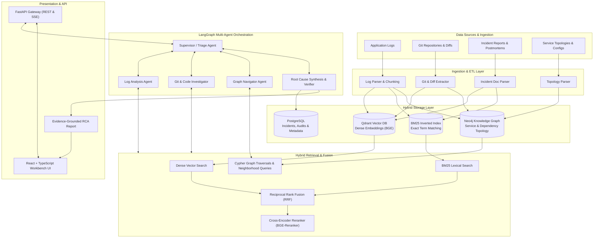
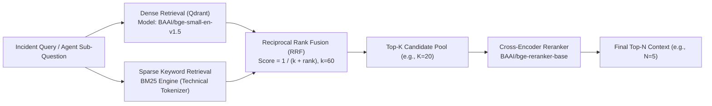
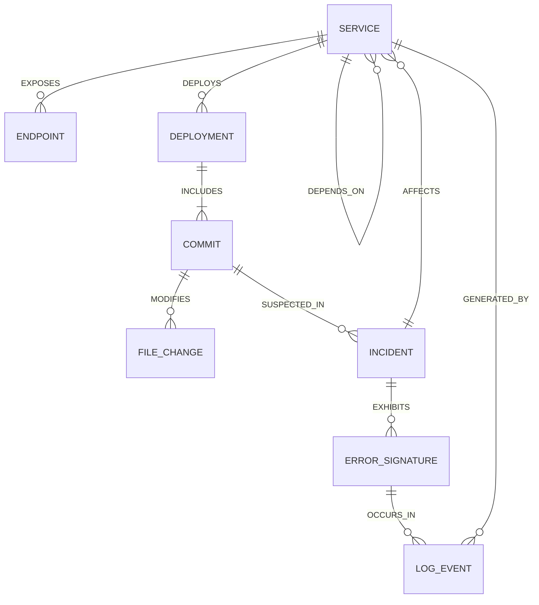
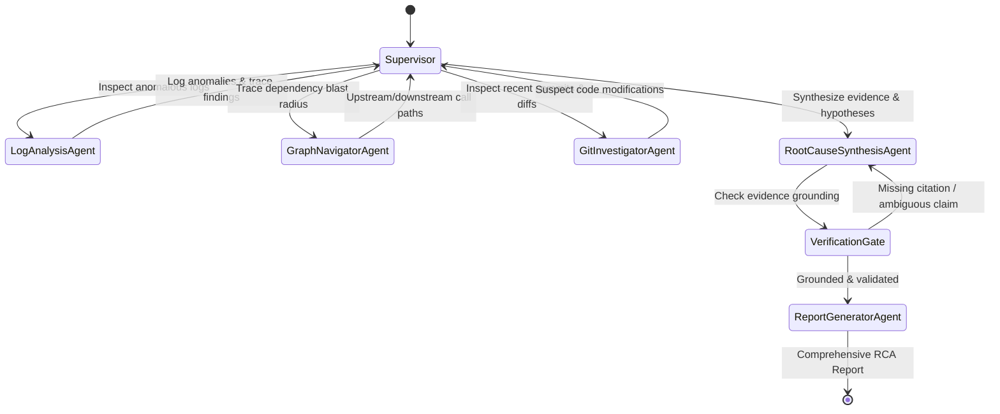
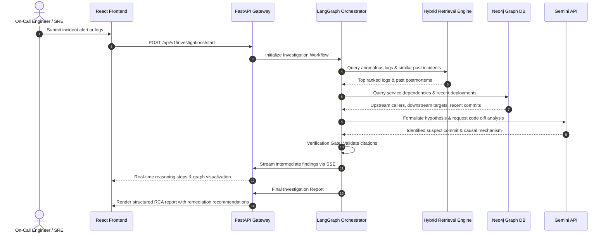
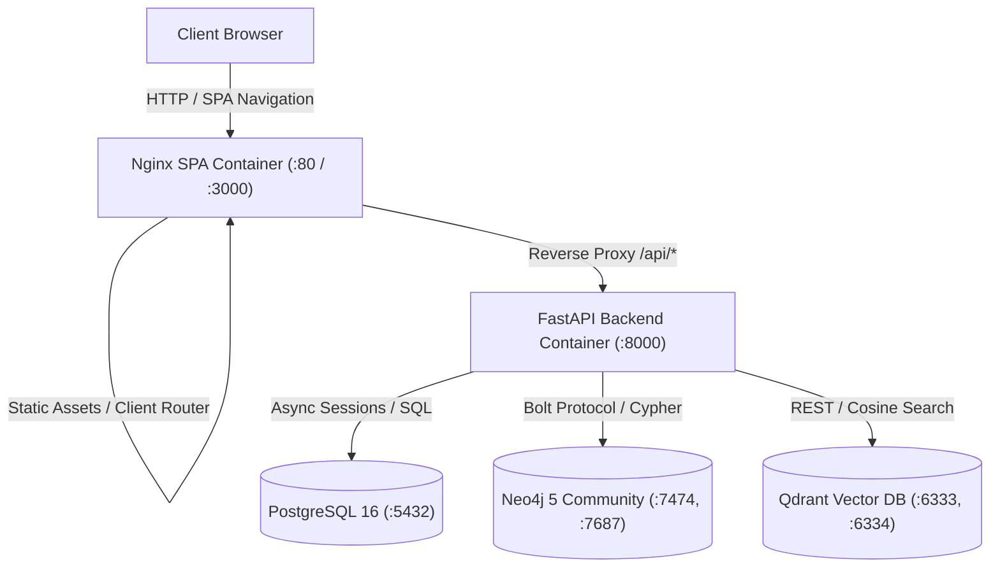

# DebugGraph AI — Architecture Specification

## 1. Executive Summary & System Overview

**DebugGraph AI** is an enterprise-grade, agentic Root Cause Analysis (RCA) and incident investigation platform. Modern distributed systems fail in complex, non-linear ways: a database connection pool exhaustion in Service A can manifest as cascading timeouts in Service B and HTTP 500 errors in Service C, all triggered by a minor configuration change deployed two commits prior.

Traditional observability tools show *symptoms* (spikes in error metrics, traces, stack traces). DebugGraph AI uncovers *causality* by combining:
1. **Multi-Source Ingestion**: Unified parsing of unstructured logs, Git commits, code diffs, service dependency maps, and past postmortems.
2. **Hybrid Retrieval**: Dense semantic vector search (Qdrant with BGE embeddings) fused with lexical keyword search (BM25), merged through Reciprocal Rank Fusion (RRF) and scored with a Cross-Encoder Reranker.
3. **Graph-Grounded Context (Neo4j)**: A rich knowledge graph mapping microservice dependencies, deployments, commits, and error signatures.
4. **Agentic Multi-Step Reasoning (LangGraph + Gemini)**: Autonomous specialized agents that collaborate to inspect logs, query graph relations, review code diffs, verify hypotheses, and generate evidence-grounded incident reports.

---

## 2. High-Level Architecture Diagram



---

## 3. Multi-Source Ingestion Pipeline

The ingestion layer translates heterogeneous unstructured and structured data into queryable representations for both vector and graph stores.

### 3.1 Ingestion Targets
1. **Application Logs**:
   - Formats: JSON structured logs, standard log4j/syslog, unstructured traceback dumps.
   - Processing: Timestamp extraction, log severity normalization (`ERROR`, `WARN`, `CRITICAL`), anomaly detection, stack trace extraction, and semantic chunking with sliding context windows.
2. **Git Repositories & Diffs**:
   - Commit metadata (author, timestamp, commit message, SHA).
   - Unified diff parsing (`git diff` hunks), affected files, changed functions/classes, and commit linkage to issue trackers.
3. **Past Incidents & Postmortems**:
   - Markdown, Jira tickets, and postmortem incident reports containing problem descriptions, mitigation steps, and verified root causes.
4. **Service Topologies & Architecture**:
   - Kubernetes manifests, OpenAPI specs, and microservice RPC dependency definitions.

---

## 4. Hybrid Retrieval Engine

Incident investigation queries are characterized by a combination of high-cardinality exact tokens (e.g., error codes like `ERR_CONNECTION_RESET`, `DB-1045`, `HTTP 500`, exception names like `ConnectionTimeoutError`, transaction IDs, IP addresses) and broad conceptual semantics (e.g., "memory leak during batch processing"). A pure vector search fails on exact tokens, while a pure keyword search fails on semantic nuance.



### 4.1 Retrieval Pipeline Components
1. **Dense Retrieval & Vector Indexing (Qdrant)**:
   - Model: `BAAI/bge-small-en-v1.5` (384-dimensional dense embeddings, normalized).
   - Asymmetric Query Encoding: Queries prepended with recommendation prefix `"Represent this sentence for searching relevant passages: "`, while document chunks are encoded clean.
   - Vector Database: Qdrant collection `debuggraph_logs` with Cosine distance.
   - Fault Tolerance: Seamless automatic fallback to disk-backed embedded storage (`qdrant_local_storage`) when remote Qdrant is unreachable.
   - Idempotent Indexing: Re-indexing an ingestion deletes prior points by `ingestion_id` before upserting.
   - Metadata Payload: Each point carries `ingestion_id`, `chunk_id`, `service_name`, `severities`, `timestamp_start/end`, `source_line_start/end`, `source_entry_ids`, `exception_signatures`, and `request_ids`.

2. **Sparse Lexical Retrieval (BM25 Engine)**:
   - Specialized Technical Tokenizer: Custom regex token extractor preserving technical identifiers:
     - Dotted file/module paths: `app.services.payment_processor`
     - Hyphenated compound identifiers and services: `payment-service`, `k8s-deployment`
     - Error codes and HTTP statuses: `DB-1045`, `HTTP 500`, `Errno 98`
     - CamelCase exception names: `ConnectionTimeoutError`, `NullPointerException`
     - Status tokens, ports, and hex IDs: `0x7f9a`, `:8080`, `txn_3391`
   - Lucene Non-Negative IDF Floor: Standard `rank-bm25` yields negative IDF for terms appearing in $\ge 50\%$ of filtered candidate chunks. The engine floors IDF values at $0.25$, guaranteeing positive term weights and preventing false candidate dropouts.
   - In-Memory Corpus Caching: In-memory cache loaded from SQLAlchemy database with automatic invalidation whenever new chunks are indexed.

3. **Reciprocal Rank Fusion (RRF)**:
   - Parameter-free rank combination merging disjoint candidate lists from Dense and BM25 retrievers:
     $$\text{RRF Score}(d) = \sum_{m \in \{\text{dense}, \text{bm25}\}} \frac{1}{k + r_m(d)}$$
   - Default smoothing constant $k = 60$.
   - Duplicate Chunk Merging: Deduplicates identical chunks retrieved by both engines, summing their reciprocal rank weights and recording individual ranks and raw scores.
   - Deterministic Tie-Breaking: Broken first by RRF score, then by raw dense score, and finally by chunk ID.

4. **Cross-Encoder Reranking**:
   - Model: `BAAI/bge-reranker-base`.
   - Computes full cross-attention over `(query, document_text)` pairs for the top RRF candidate pool.
   - Singleton Pattern & Lazy Loading: Prevents multi-gigabyte memory churn by maintaining a shared singleton instance.
   - Score Transparency: Raw Cross-Encoder outputs are uncalibrated logits and are explicitly surfaced in diagnostics without deceptive conversion into probabilities or confidence percentages.

5. **Retrieval Diagnostics & Explainability**:
   Every retrieved hit returns full structured diagnostics:
   ```json
   {
     "retrieval_methods": ["dense", "bm25"],
     "dense_rank": 1,
     "bm25_rank": 1,
     "dense_score": 0.8912,
     "bm25_score": 4.8215,
     "rrf_score": 0.032787,
     "reranker_score": 3.4812
   }
   ```

### 4.2 Empirical Retrieval Benchmark Results
The hybrid retrieval engine was rigorously benchmarked across 32 realistic production incident queries spanning 6 technical incident categories (exact error codes, semantic incident queries, service-specific failures, exception stack traces, database pool/deadlock failures, and Kubernetes deployment crashes):

| Retrieval Strategy | Recall@5 | Precision@5 | MRR@5 | NDCG@5 |
| :--- | :---: | :---: | :---: | :---: |
| **A: Dense Only** (`bge-small-en-v1.5`) | 1.0000 | 0.2688 | 0.8854 | 0.9106 |
| **B: BM25 Only** (Technical Tokenizer) | 1.0000 | 0.2688 | 1.0000 | 1.0000 |
| **C: Hybrid RRF** ($k=60$) | 1.0000 | 0.2688 | 0.9688 | 0.9744 |
| **D: Hybrid RRF + Reranker** (`bge-reranker-base`) | **1.0000** | **0.2688** | **0.9750** | **0.9808** |

#### Key Empirical Observations:
1. **Sparse Precision on Error Codes**: BM25 with specialized tokenization achieved perfect MRR on exact token queries (`DB-1045`, `HTTP 500`, `exit code 137`), where dense embeddings sometimes place generic error logs ahead of the specific code match.
2. **Dense Complementarity on Conceptual Queries**: For broad queries like *"Why are payment checkout transactions failing?"*, dense vector search surfaced conceptually relevant root-cause chunks even when exact keywords were absent.
3. **Cross-Encoder Precision Lift**: Adding `BAAI/bge-reranker-base` after RRF increased MRR@5 from $0.9688$ to $0.9750$ and NDCG@5 from $0.9744$ to $0.9808$, ensuring the most contextually relevant evidence chunk is ranked at position 1.

---

## 5. Neo4j Knowledge Graph Schema & Ontology

DebugGraph AI models structural dependencies and temporal incident events as an interconnected graph, allowing the agents to traverse causal chains.



### 5.1 Node Entities
- `(:Service)`: Microservice or background worker (e.g., `payment-service`, `auth-api`).
- `(:Endpoint)`: API route or RPC endpoint (e.g., `POST /v1/checkout`).
- `(:Deployment)`: Deployment instance with timestamp and target environment.
- `(:Commit)`: Git commit node containing SHA, author, and timestamp.
- `(:FileChange)`: Path to modified source code file, function, or configuration.
- `(:ErrorSignature)`: Distinct clustering of exceptions (e.g., `DatabaseConnectionTimeoutException`).
- `(:Incident)`: Tracked production event with severity, time window, and state.

### 5.2 Relationship Types
- `[:CALLS]`: Synchronous HTTP/gRPC invocation from one service to another.
- `[:DEPENDS_ON]`: Asynchronous or infrastructure dependency (e.g., Redis cache, Postgres DB).
- `[:MODIFIES]`: Commit modifying a specific file or module.
- `[:EXHIBITS]`: Incident showing specific error patterns in logs.
- `[:INTRODUCED_DURING]`: Error signature first observed after a specific deployment.

---

## 6. Multi-Agent Orchestration with LangGraph

Incident diagnosis requires reasoning over multiple distinct facets of the software delivery lifecycle. Rather than relying on a single monolithic prompt, DebugGraph AI utilizes a specialized multi-agent graph powered by **LangGraph**.



### 6.1 Agent Roles
1. **Supervisor / Triage Agent**:
   - Decomposes the initial incident alert into targeted investigation questions.
   - Coordinates worker agents and maintains the global investigation state.
2. **Log Analysis Agent**:
   - Queries hybrid retrieval for high-severity log patterns, exception stack traces, and temporal error anomalies.
   - Extracts relevant trace IDs and timestamps.
3. **Graph Navigator Agent**:
   - Traverses Neo4j to find which upstream and downstream services are connected to the failing service.
   - Checks what recent deployments took place prior to the onset of the error.
4. **Git & Code Investigator Agent**:
   - Retrieves git diffs and commits associated with suspect deployments.
   - Pinpoints regressions, missing error handling, or schema changes in changed code.
5. **Root Cause Synthesis & Verification Agent**:
   - Fuses evidence across logs, topology, and code changes into candidate root cause hypotheses.
   - **Verification Gate**: Enforces that every single claim is backed by direct citations (exact log line, commit SHA, or graph dependency).
6. **Report Generator Agent**:
   - Formats the verified findings into a standardized postmortem and remediation guide.

---

## 7. Storage & Infrastructure Architecture

| Component | Technology | Primary Responsibility |
| :--- | :--- | :--- |
| **Relational Database** | PostgreSQL 16 | Storage of incident records, investigation session states, user feedback, audit history, and cached reports. |
| **Vector Database** | Qdrant | Dense vector indexing of logs, code diff chunks, and past postmortems with metadata filtering. |
| **Knowledge Graph** | Neo4j 5 Community | Entity-relationship graph for microservice architecture, deployments, and commit lineage. |
| **Backend API** | FastAPI / Python 3.11+ | Asynchronous REST endpoints, agent execution runtime, and Server-Sent Events (SSE) streaming for real-time investigation steps. |
| **Frontend UI** | React / Vite / Tailwind | Interactive incident investigation console, real-time agent thought graph visualization, and interactive postmortem viewer. |
| **Orchestration** | Docker Compose | Multi-container reproducible development and deployment environment. |

---

## 8. Data Flow Lifecycle



---

## 9. Evaluation & Benchmarking Strategy

To ensure reliability in production operations, DebugGraph AI implements rigorous evaluation pipelines:
1. **Retrieval Evaluation**:
   - **Recall@K** and **MRR (Mean Reciprocal Rank)** for log and code chunk retrieval.
   - **Precision@K** on historical incident postmortem matching.
2. **RAG Triad Assessment**:
   - **Context Relevance**: Are retrieved logs and code snippets relevant to the incident?
   - **Groundedness**: Does every statement in the RCA stem directly from the retrieved context?
   - **Answer Relevance**: Does the final diagnosis directly resolve the incident alert?
3. **End-to-End RCA Accuracy**:
   - Evaluated on benchmark incidents (`datasets/evaluation/`) where the ground truth root cause and culprit commit are known.
4. **Safety & Hallucination Guardrails**:
   - Strict refusal to fabricate commit SHAs, line numbers, or error traces not present in the verified context.

---

## 10. Frontend Architecture & Interaction Model

The DebugGraph AI dashboard is built as a single-page application (SPA) using React 18, TypeScript, Vite, Tailwind CSS, and `@xyflow/react` for topology visualization:

1. **Operations Overview (`/overview`)**:
   - Real-time telemetry: counts for indexed log chunks, service entities, active incidents, and subsystem health.
   - Live incident feed and quick-launch demo scenarios for instant RCA execution.
2. **Investigation Workspace (`/investigations`)**:
   - Investigation triggering for both single-pass Gemini and LangGraph multi-agent workflows.
   - Multi-agent timeline component tracking execution states of all 7 agents.
   - Ranked root cause hypotheses with confidence meters, observations, and verified log citations.
   - Integrated blast radius impact and commit diff correlations.
3. **Log Ingestion & Hybrid Explorer (`/logs`)**:
   - Drag-and-drop log file uploader sending multipart data to `/api/v1/logs/upload`.
   - Real-time search testing across dense vectors, BM25 keywords, and cross-encoder scores.
4. **Service Dependency Graph (`/graph`)**:
   - React Flow node-edge graph canvas supporting drag, zoom, minimap, and auto-layout.
   - Custom nodes for microservices, databases, and APIs.
   - Interactive blast radius calculation highlighting cascading impact paths in real time.
5. **GitHub Intelligence (`/github`)**:
   - Repository registration and commit timeline tracking.
   - Colorized unified Git diff viewer with chunk indicators and change stats.
6. **Evaluation & Benchmarks (`/evaluation`)**:
   - Visual comparison charts via Recharts for retrieval accuracy (Dense vs BM25 vs Hybrid vs Reranker) and multi-agent fidelity.
   - Downloadable reports in Markdown and JSON formats.
7. **Settings & Health (`/settings`)**:
   - Live connectivity checks across all external subsystems (FastAPI, Qdrant, Neo4j, Gemini, GitHub).
   - Display of retrieval hyperparameters (BM25, RRF k=60, BGE-reranker) and index management.

---

## 11. Containerization & Production Deployment

DebugGraph AI is fully orchestrated via Docker Compose for production deployments:



- **SPA Routing**: Nginx uses `try_files $uri $uri/ /index.html` to prevent 404s on browser reloads.
- **Extended Timeouts**: Proxy timeouts set to 180s to accommodate deep multi-agent LLM reasoning chains.
- **Healthchecks**: Strict Docker health checks on all dependent services ensure safe boot order and zero downtime restarts.


