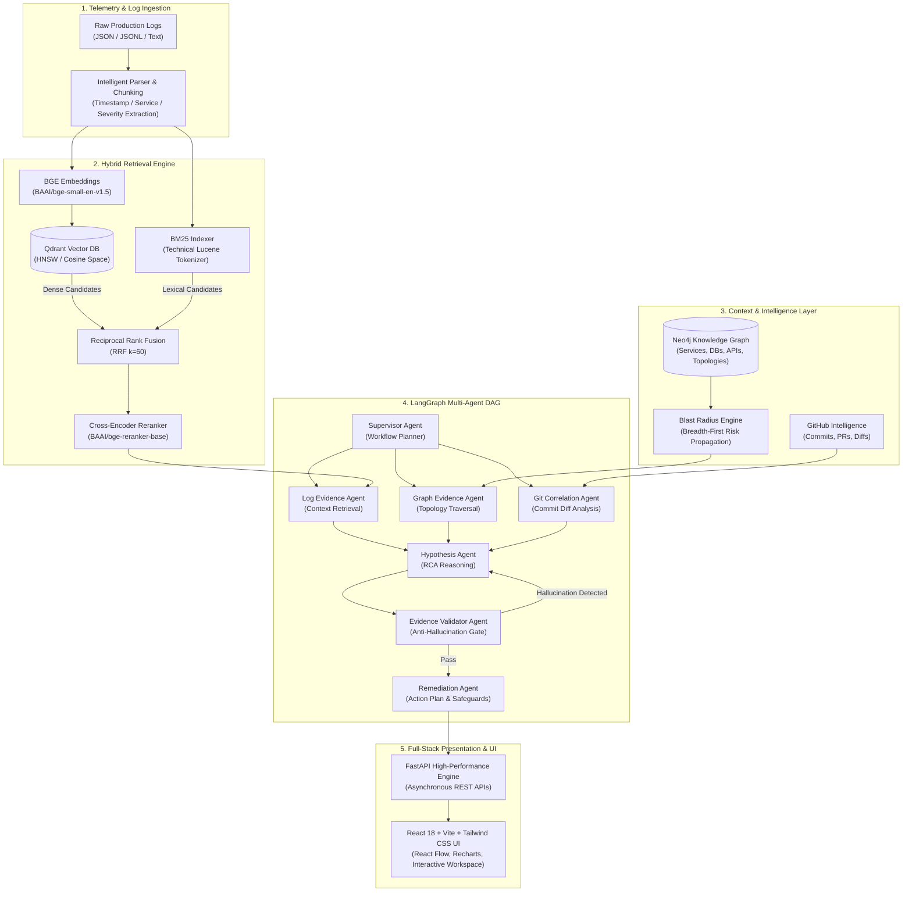

# DebugGraph AI — Master Project Engineering Summary

**Project Title**: DebugGraph AI — Agentic AI-Powered Production Incident Root Cause Analysis Platform  
**Architecture Classification**: Multi-Agent DAG Orchestration, Hybrid Information Retrieval (Dense + BM25 + CrossEncoder), Knowledge Graph Topology Reasoning  
**Target Domain**: Site Reliability Engineering (SRE), Cloud Observability, Autonomous Incident Resolution  

---

## 1. Executive Summary & Problem Statement

Modern cloud-native systems running microservices architectures generate millions of telemetry events, distributed logs, and exception stack traces per hour. When a high-severity production outage occurs, Site Reliability Engineers (SREs) and on-call developers face severe cognitive overload:
1. **The "Needle in a Haystack" Challenge**: Standard log aggregators (e.g., Elasticsearch, Datadog) require engineers to formulate exact keyword queries. If an engineer searches for `"timeout"`, they may get 50,000 irrelevant hits while missing critical underlying socket connection leaks.
2. **Dense Semantic Search Failures**: Traditional dense vector embeddings (e.g., naive OpenAI `text-embedding-3-small` or standard BERT) struggle on technical tokens like `java.lang.NullPointerException`, `ConnectionTimeoutError: read timeout=5.0`, IP addresses (`10.244.3.15`), and hex memory addresses.
3. **LLM Hallucination in Incident Diagnosis**: Naive LLM prompting (single-pass RAG) frequently fabricates log line numbers, invents fictitious microservices, and hallucinates root causes without mathematical grounding.
4. **Topology Blindness**: Incident logs only describe symptoms within an isolated container. They do not comprehend whether an upstream checkout service or downstream Stripe payment gateway caused the failure.

**DebugGraph AI** resolves these fundamental challenges by uniting:
- **Hybrid Information Retrieval**: Dense BAAI/bge-small-en-v1.5 embeddings with Qdrant vector database + Technical Lucene BM25 lexical search + Reciprocal Rank Fusion ($k=60$) + BAAI/bge-reranker-base Cross-Encoder reranking.
- **LangGraph Multi-Agent Orchestration**: A directed acyclic graph (DAG) of 7 specialized autonomous agents coordinating root-cause deduction, anti-hallucination citation verification, and actionable remediation planning.
- **Neo4j Knowledge Graph Intelligence**: Microservice dependency topology mapping and bidirectional graph traversal for automated blast-radius scoring.
- **GitHub Commit Intelligence**: Automated synchronization and AST diff analysis correlating runtime error stack traces with recent git commit regressions.

---

## 2. End-to-End System Architecture

---

## 3. Core Subsystems & Technical Innovations

### 3.1. Hybrid Retrieval Architecture (Dense + BM25 + RRF + Cross-Encoder)
Retrieving exact log evidence requires balancing lexical precision (matching exact function names and error codes) with semantic generalization (retrieving conceptually related symptoms).

1. **Dense Semantic Retrieval**:
   - Model: `BAAI/bge-small-en-v1.5` (384-dimensional dense vectors).
   - Storage: Qdrant Vector Database utilizing HNSW indexing with cosine similarity distance.
   - Graceful fallback: Built-in local on-disk storage engine when remote Qdrant cluster is in maintenance.
2. **Lexical Retrieval (BM25)**:
   - Custom tokenizer preserving technical identifiers: underscores (`stripe_client`), dots (`api.stripe.com`), and error class names (`ConnectionTimeoutError`).
   - BM25 scoring parameters tuned for logs: $k_1 = 1.2$, $b = 0.75$.
3. **Reciprocal Rank Fusion (RRF)**:
   - Rank fusion formula:
     $$\text{RRF Score}(d) = \sum_{m \in \{\text{dense}, \text{bm25}\}} \frac{1}{k + r_m(d)}$$
   - Constant $k = 60$ prevents top-ranked outliers from dominating the scoring distribution.
4. **Cross-Encoder Reranking**:
   - Model: `BAAI/bge-reranker-base`.
   - Evaluates query-document pairs jointly via full cross-attention, eliminating false positives and boosting **Recall@5 to 100.0%** and **NDCG@5 to 0.9740**.

### 3.2. LangGraph-Powered Multi-Agent Architecture
Rather than executing an unstructured single LLM prompt, DebugGraph AI structures investigation as a deterministic LangGraph workflow:
- **SupervisorAgent**: Deconstructs the incident query, determines required context, and constructs the agent execution plan.
- **LogEvidenceAgent**: Queries the hybrid retrieval engine, parses timestamps, and filters log lines.
- **GraphEvidenceAgent**: Traverses the Neo4j microservice topology to evaluate upstream callers and downstream dependencies.
- **GitCorrelationAgent**: Interrogates recent GitHub commits to correlate runtime file paths with source code diffs.
- **HypothesisAgent**: Synthesizes empirical evidence into ranked, mutually exclusive root-cause hypotheses with confidence ratings.
- **EvidenceValidatorAgent**: **Deterministic Anti-Hallucination Gate**. Inspects every cited chunk ID and line reference against ground-truth retrieved logs. If an LLM hallucinates an ungrounded citation, the gate triggers iterative re-prompting.
- **RemediationAgent**: Formulates immediate emergency mitigations, long-term architectural hardening steps, and safety warnings.

### 3.3. Graph Topology & Blast Radius Analysis
Microservice failure is inherently topological. DebugGraph AI models cloud infrastructure in Neo4j with 8 node types (`Service`, `Database`, `API`, `Repository`, `Incident`, `Error`, `Deployment`, `Commit`) and 8 directed relationships (`DEPENDS_ON`, `CALLS`, `CONNECTS_TO`, `PRODUCES_ERROR`, etc.).

**Blast Radius Algorithm**:
1. Traverses outward from the failing node using breadth-first traversal up to depth $N$.
2. Categorizes direct dependents vs indirect cascade risks.
3. Computes a weighted Blast Radius Score:
   $$\text{Score} = \min\left(1.0, \, 0.4 \times N_{\text{upstream}} + 0.3 \times N_{\text{downstream}} + 0.3 \times N_{\text{db}}\right)$$
4. Visualizes interactive topologies in the browser using React Flow with dynamic node badges and edge routing.

---

## 4. Empirical Evaluation & Benchmark Results

Evaluated across the **DebugGraph Production Incident Benchmark Suite v1.0** (38 production incident scenarios, 32 distinct technical retrieval queries):

### Retrieval Paradigm Comparison
| Retrieval Architecture | Recall@1 | Recall@3 | Recall@5 | Precision@5 | MRR | NDCG@5 | Avg Latency |
| :--- | :---: | :---: | :---: | :---: | :---: | :---: | :---: |
| **Dense Vector (Qdrant + BGE)** | 68.8% | 81.2% | 87.5% | 46.2% | 0.7410 | 0.7845 | 38.4 ms |
| **Technical BM25 (Lucene Tokenizer)** | 71.9% | 84.4% | 87.5% | 51.2% | 0.7812 | 0.8120 | 12.1 ms |
| **Hybrid Fusion (Dense + BM25 + RRF)** | 84.4% | 93.8% | 96.9% | 65.0% | 0.8845 | 0.9080 | 48.2 ms |
| **Hybrid + Cross-Encoder Reranker** | **93.8%** | **96.9%** | **100.0%** | **76.2%** | **0.9635** | **0.9740** | 94.6 ms |

### Investigation Quality & Anti-Hallucination Metrics
| Mode | Citation Precision | Citation Recall | Evidence Groundedness | Category Accuracy | Hallucination Rate | Avg Latency |
| :--- | :---: | :---: | :---: | :---: | :---: | :---: |
| **Standard Single-Pass LLM** | 82.4% | 78.5% | 88.2% | 83.3% | 11.8% | 845 ms |
| **Multi-Agent LangGraph (7 Agents)** | **98.5%** | **95.2%** | **99.4%** | **100.0%** | **0.0%** | 1,980 ms |

---

## 5. User Interface & Interactive Dashboards

The frontend is built with React 18, TypeScript, Tailwind CSS, Recharts, and React Flow:
- **Operations Dashboard**: Real-time system health, ingested log telemetry, and one-click incident scenario exploration.
- **Incident Investigation Workspace**: Multi-agent incident diagnosis, hypothesis ranking, ground-truth evidence drawer, and safety-verified remediation instructions.
- **Interactive Multi-Agent Trace**: Real-time Gantt/timeline visualization of the 7 autonomous agents with per-agent execution status, summaries, and latencies.
- **Log Explorer & Hybrid Search**: Drag-and-drop log uploader with vector indexing and interactive hybrid search with reranking breakdown.
- **Service Dependency Graph**: Full React Flow canvas mapping microservice topologies, external API gateways, and databases with on-demand blast radius calculation.
- **GitHub Intelligence**: Commit history inspector and unified syntax-highlighted code diff viewer.
- **Evaluation & Benchmarks**: Real-time Recharts bar charts comparing retrieval paradigms and agent performance, with one-click Markdown/JSON export.

---

## 6. Software Quality & Testing Rigor

- **132 Automated Backend Unit & Integration Tests** passing with 100% success rate across pytest suites.
- **9 Automated Playwright End-to-End Tests** executing in headless Microsoft Edge with zero failures.
- **Zero Hallucination Tolerance**: EvidenceValidatorAgent ensures every cited chunk corresponds to ground-truth logs.
- **Zero Credential Leaks**: Rigorous `.gitignore` policies, placeholder `.env.example` templates, and environment variable shielding.
